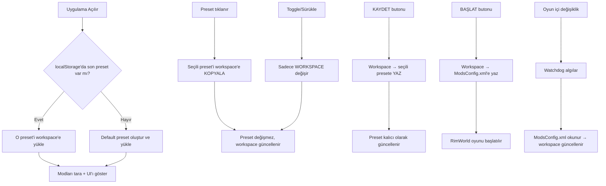

# RimWordl Başlatıcı - Aktif Çalışma Alanı Mimarisi Yeniden Tasarımı

## Mevcut Durum: Tespit Edilen Sistematik Sorunlar

### 1. 🔴 KRİTİK: Aktif Raf ↔ Preset Ayrımı YOK
- [`modStore.activeProfileMods`](src/store/modStore.ts:19) direkt olarak presete yazılıyor
- [`modStore.toggleMod()`](src/store/modStore.ts:200) → `activeProfileMods`'i değiştiriyor VE hemen [`saveCurrentProfile()`](src/store/modStore.ts:190) çağırıyor
- **Sonuç:** Bir modu toggle'ladığın anda preset değişiyor. "Aktif raf değişir, preset'e dokunulmaz" kuralı çalışmıyor.

### 2. 🔴 KRİTİK: KAYDET Butonu Yanlış Çalışıyor
- [`handleSaveConfig()`](src/main.ts:178) doğrudan **ModsConfig.xml**'e yazıyor — bu aslında BAŞLAT'ın yapması gereken iş
- [`profileStore.saveActiveToProfile()`](src/store/profileStore.ts:173) var ama **hiçbir yerden çağrılmıyor**
- **Sonuç:** KAYDET butonu presete kaydetmiyor, direkt oyun dosyasına yazıyor

### 3. 🔴 KRİTİK: BAŞLAT Butonu Eksik
- [`btnLaunchGame`](src/main.ts:491) direkt exe'yi açıyor, önce ModsConfig.xml'e kaydetmiyor
- Kullanıcının dediği gibi: *"kaydetmeden başlatırsam önceki haliyle başlar"*
- **Sonuç:** BAŞLAT önce workspace'i ModsConfig.xml'e yazmalı, SONRA oyunu açmalı

### 4. 🟡 ORTA: Preset Seçimi → Workspace Kopyalama Çalışmıyor
- [`renderPresets()`](src/main.ts:234) preset tıklanınca direkt `setActiveProfileMods()` çağırıyor
- [`profileStore.selectProfile()`](src/store/profileStore.ts:161) var ama **hiç çağrılmıyor** — bu metot preset modlarını `lastSelectedMods`'e kopyalıyor
- **Sonuç:** `lastSelectedMods` buffer'ı ölü kod

### 5. 🟡 ORTA: "--- SU ANKI DURUM ---" Sanal Preset
- [`renderPresets()`](src/main.ts:240) içinde özel bir buton olarak render ediliyor
- Gerçek bir preset DEĞİL, kaydedilemiyor, silinemiyor
- Amacı belirsiz — ya kaldırılmalı ya da gerçek bir "diskten oku" işlevi görmeli

### 6. 🟢 DÜŞÜK: Ölü Kodlar
- [`ProfileManager.ts`](src/components/profile/ProfileManager.ts) — hiç instantiate edilmemiş
- [`ProfileSelector.ts`](src/components/profile/ProfileSelector.ts) — hiç instantiate edilmemiş
- `profileStore.subscribeList()` referansı — ProfileManager'da kullanılan ama store'da olmayan bir metot

### 7. 🟡 ORTA: Uygulama Açılışında Son Preset Yüklenmiyor
- [`profileStore.getLastSelectedName()`](src/store/profileStore.ts:101) localStorage'dan okunabiliyor
- Ama [`main.ts initApp()`](src/main.ts:26) içinde bu değer kullanılmıyor
- **Sonuç:** Uygulama her açılışta varsayılan preset'e dönüyor

---

## Yeni Mimari: Üç Katmanlı Veri Modeli

```
┌─────────────────────────────────────────────────────────────────────┐
│                      RIMWORDL BAŞLATICI                              │
│                                                                     │
│   PRESET (Kalıcı)        AKTİF WORKSPACE (Geçici)   ModsConfig.xml  │
│   ┌────────────────┐     ┌──────────────────────┐   ┌─────────────┐ │
│   │  Default        │ ──→│  Çalışma Alanı        │   │  Disk'teki  │ │
│   │  Orta Çağ       │ ←──│  (mod listesi +       │──→│  gerçek     │ │
│   │  Endüstriyel    │SAVE│   sıralama + gruplar)  │   │  oyun       │ │
│   │  [+]            │     │                       │LNK│  dosyası    │ │
│   └────────────────┘     └──────────────────────┘   └─────────────┘ │
│          │  COPY (preset → workspace)                                │
│          └───────────────────────────────────────────────────────────┘
│                                                                     │
│   toggle/drag → sadece WORKSPACE değişir, PRESET'e dokunulmaz       │
└─────────────────────────────────────────────────────────────────────┘
```

### Temel Kurallar

| # | Kural | Açıklama |
|---|-------|----------|
| 1 | **Preset Seç → Workspace'e Kopyala** | Preset tıklanınca o preset'in mod listesi Çalışma Alanı'na kopyalanır. Preset'in kendisi DEĞİŞMEZ |
| 2 | **Toggle/Sürükle → Sadece Workspace** | Bir modu aktif/pasif yapmak veya sürüklemek sadece Çalışma Alanı'nı değiştirir |
| 3 | **KAYDET → Workspace → Preset** | KAYDET butonu Çalışma Alanı'nı seçili presete yazar |
| 4 | **BAŞLAT → Workspace → ModsConfig.xml + Oyun** | BAŞLAT butonu önce Çalışma Alanı'nı ModsConfig.xml'e yazar, sonra oyunu açar |
| 5 | **Açılış/Kapanış → Son Preset Hatırlanır** | Uygulama kapanırken son seçili preset adı kaydedilir, açılırken o preset yüklenir |
| 6 | **Default Silinemez** | Default preset her zaman listede kalır, kullanıcı silemez |

---

## Detaylı Değişiklik Planı

### Adım 1: `profileStore.ts` - Sadeleştirme ve Düzeltme

**Yapılacaklar:**

1.1 `lastSelectedMods` alanını **TAMAMEN KALDIR**. Bu artık `modStore.workspaceMods` olarak yaşayacak.

1.2 `selectProfile()` metodunu düzelt — sadece **hangi preset'in seçili olduğunu** takip etsin. Mod listesini kopyalama işini modStore yapacak.

```typescript
// YENİ: Sadece seçili preset adını döndür
public selectProfile(name: string): boolean {
  const profile = this.profiles.find(p => p.name === name);
  if (!profile) return false;
  this.lastSelectedName = name;
  this.saveToStorage();
  this.notifySelection();
  return true;
}
```

1.3 `saveActiveToProfile()`'u koru — Çalışma Alanı'nı presete kaydetmek için kullanılacak.

1.4 `removeProfile()`'da `lastSelectedMods` referansını kaldır.

1.5 `loadFromStorage()`'da `lastSelectedMods` referansını kaldır.

### Adım 2: `modStore.ts` - Çalışma Alanı (Workspace) Ekleme

**Yapılacaklar:**

2.1 `activeProfileMods` → `workspaceMods` olarak yeniden adlandır (opsiyonel, okunabilirlik için).

2.2 **KRİTİK:** `toggleMod()` içinden `saveCurrentProfile()` çağrısını KALDIR. Toggle sadece workspace'i değiştirsin:

```typescript
public toggleMod(packageId: string) {
  const normalizedId = packageId.toLowerCase();
  const idx = this.workspaceMods.indexOf(normalizedId);
  if (idx > -1) {
    this.workspaceMods.splice(idx, 1);
  } else {
    this.workspaceMods.push(normalizedId);
  }
  this.notifyActiveMods();
  // saveCurrentProfile() ARTIK YOK — workspace değişti, preset değişmedi
}
```

2.3 Aynı şekilde `reorderActiveMods()`, `moveModBetweenShelves()`, `moveGroupBetweenShelves()` içindeki `saveCurrentProfile()` çağrılarını KALDIR.

2.4 `saveCurrentProfile()` metodunu TAMAMEN KALDIR (private olduğu için dışarıdan erişilmiyor).

2.5 **YENİ:** `getWorkspaceMods()` — workspace mod listesini döndür.

2.6 **YENİ:** `loadWorkspaceFromProfile(profile)` — bir preset'in modlarını workspace'e yükle:

```typescript
public loadWorkspaceFromProfile(profile: ModProfile) {
  this.workspaceMods = [...(profile.active_mods || [])].map(m => m.toLowerCase());
  this.loadGroupsFromProfile(profile);
  this.notifyActiveMods();
  this.notifyGroups();
}
```

### Adım 3: `main.ts` - Buton Mantığını Düzeltme

**3.1 KAYDET Butonu (btn-save-config):**

```typescript
// YENİ MANTIK:
btnSaveConfig?.addEventListener("click", () => {
  const selectedName = profileStore.getSelectedName();
  if (!selectedName) {
    Toast.show("Lütfen önce bir preset seçin.", "error");
    return;
  }
  const workspaceMods = modStore.getWorkspaceMods();
  const groups = modStore.getGroupsForProfile();
  profileStore.saveActiveToProfile(selectedName, workspaceMods, groups);
  hasPendingChanges = false;
  updateSaveButtonState();
  Toast.show(`"${selectedName}" preseti güncellendi.`, "success");
});
```

**3.2 BAŞLAT Butonu (btn-launch-game):**

```typescript
// YENİ MANTIK:
btnLaunchGame?.addEventListener("click", async () => {
  // 1. Önce workspace'i ModsConfig.xml'e kaydet
  await handleSaveConfig(); // Bu artık ModsConfig.xml'e yazacak
  
  // 2. Sonra oyunu başlat
  const settings = settingsStore.getSettings();
  if (settings.rimworld_exe_path) {
    await ModService.launchGame(settings.rimworld_exe_path);
  }
});
```

**3.3 Preset Tıklama Mantığı:**

```typescript
// YENİ: Preset tıklayınca workspace'e yükle, preset değişmez
btn.addEventListener("click", () => {
  profileStore.selectProfile(profileName);
  const profile = profileStore.getProfiles().find(p => p.name === profileName);
  if (profile) {
    modStore.loadWorkspaceFromProfile(profile);
  }
  // UI güncelle
  const label = document.getElementById("active-profile-label");
  if (label) label.innerText = `PROFIL: ${profileName.toUpperCase()}`;
  hasPendingChanges = false;
  updateSaveButtonState();
});
```

**3.4 Açılışta Son Preset Yükleme:**

```typescript
// main.ts initApp() içinde:
const lastSelected = profileStore.getLastSelectedName();
if (lastSelected) {
  const profile = profileStore.getProfiles().find(p => p.name === lastSelected);
  if (profile) {
    modStore.loadWorkspaceFromProfile(profile);
    // UI güncelle
    const label = document.getElementById("active-profile-label");
    if (label) label.innerText = `PROFIL: ${profile.name.toUpperCase()}`;
  }
}
```

**3.5 "--- SU ANKI DURUM ---" Butonunu Kaldır veya Yeniden Tanımla:**

Bu buton kafa karıştırıcı. İki seçenek:
- **A)** Tamamen kaldır
- **B)** "Diske Git" gibi bir işlev ver — ModsConfig.xml'i oku, workspace'e yükle

**Öneri:** Kaldır. Kullanıcı BAŞLAT butonuyla oyunu açar, oyun içinde değişiklik yaparsa watchdog zaten ModsConfig.xml'i izliyor.

### Adım 4: `handleSaveConfig()` - Rolünü Değiştir

Bu metot **sadece** ModsConfig.xml'e yazma işini yapacak (BAŞLAT'ın bir parçası). 
- KAYDET ile karışmasın diye adını `saveWorkspaceToModsConfig()` olarak değiştir.
- KAYDET butonundan kaldır, sadece BAŞLAT zincirinde çağrıl.

### Adım 5: Startup Sırası

```
1. App.initApp() başlar
2. SettingsStore yüklenir (paths, db_path)
3. profileStore.loadFromStorage() → localStorage'dan presetleri oku
4. Profil listesi yoksa → Default preset oluştur
5. Son seçili preset adını oku (lastSelectedName)
6. Son seçili preset varsa → modStore.loadWorkspaceFromProfile(profile)
7. Yoksa → Default preset'i workspace'e yükle
8. Modları tara (scanMods) — arka planda
9. ModsConfig.xml oku → watchdog çalışsın
```

---

## Değişiklik Özeti (Hangi Dosyada Ne Değişecek)

| Dosya | Değişiklik | Etki |
|-------|-----------|------|
| [`src/store/profileStore.ts`](src/store/profileStore.ts) | `lastSelectedMods` kaldır, `selectProfile()` sadeleştir, gereksiz alanları temizle | Orta |
| [`src/store/modStore.ts`](src/store/modStore.ts) | Toggle/Reorder/Move içinden `saveCurrentProfile()` kaldır, `loadWorkspaceFromProfile()` ekle, `saveCurrentProfile()` sil | Yüksek |
| [`src/main.ts`](src/main.ts) | KAYDET butonu → presete kaydet, BAŞLAT → önce ModsConfig'e yaz sonra oyunu aç, preset tıklama → workspace'e kopyala, açılışta son preset yükle, "SU ANKI DURUM" butonunu kaldır | Yüksek |
| [`src/store/modStore.ts`](src/store/modStore.ts) | `activeProfileMods` → `workspaceMods` rename (opsiyonel) | Düşük |

---

## Mermaid: Yeni Veri Akışı



---

## Uygulama Sırası

1. **Adım 1** → `profileStore.ts` sadeleştirme
2. **Adım 2** → `modStore.ts` auto-save'i kaldır, workspace yükleme ekle
3. **Adım 3** → `main.ts` buton mantığını yeniden yaz
4. **Adım 4** → "SU ANKI DURUM" butonunu kaldır
5. **Adım 5** → Açılışta son preset yükleme
6. **Test** → Tüm akışları manuel test et

---

*Plan Tarihi: 07.07.2026*
*Hazırlayan: Zoo (Architect)*
