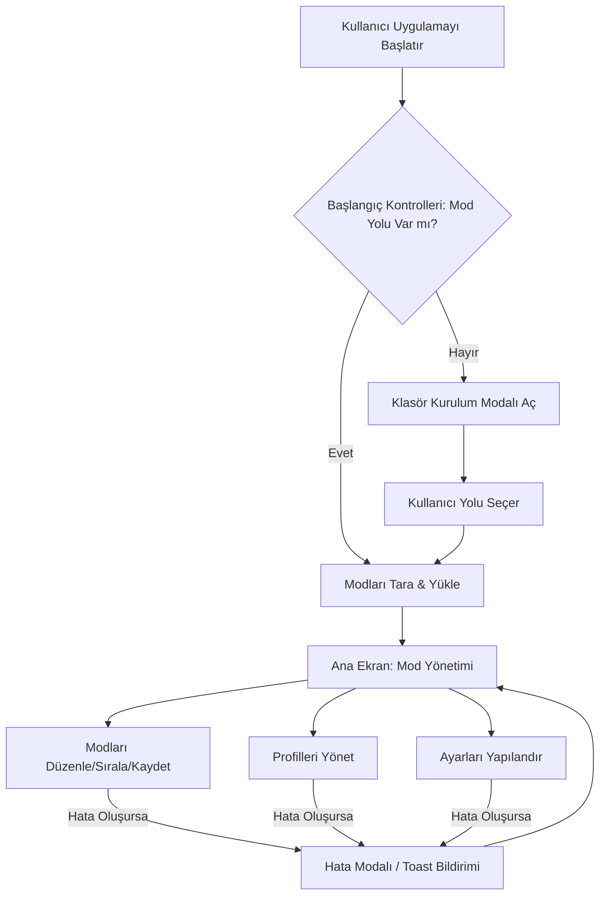

# Frontend Mimari ve Tasarım Planı

Bu belge, RimWorld Mod Helper uygulamasının kullanıcı geri bildirimleri doğrultusunda yeniden tasarlanmış ve geliştirilmiş ön yüz (frontend) mimarisi ve tasarımını detaylandırmaktadır. Amaç, modern, duyarlı ve kullanıcı dostu bir arayüz sunarken, hata yönetimi ve loglama mekanizmalarını da desteklemektir.

## 1. Modern Tasarım Dili ve Duyarlılık (Responsive Design)

### Tasarım İlkeleri

*   **Minimalizm:** Gereksiz görsel karmaşıklıktan kaçınılarak içeriğin ve işlevselliğin ön plana çıkarılması.
*   **Kullanılabilirlik:** Sezgisel navigasyon, anlaşılır etkileşimler ve öğrenme eğrisini düşüren arayüz elemanları.
*   **Erişilebilirlik:** WCAG standartlarına uygun renk kontrastları, klavye navigasyonu ve ekran okuyucu desteği ile tüm kullanıcılar için erişilebilir bir deneyim.
*   **Ölçeklenebilirlik:** Küçük mobil ekranlardan ultra geniş masaüstü monitörlere kadar farklı cihazlarda ve ekran çözünürlüklerinde sorunsuz ve adaptif çalışma.

### Renk Paleti ve Tipografi

*   **Renk Paleti:** Mevcut RimWorld temasına uygun, ancak daha modern, yumuşak gölgeler ve daha az sert sınırlarla zenginleştirilmiş bir "dark mode" paleti. Mevcut CSS değişkenleri (`src/styles.css`) güncellenecek ve yeni, daha nuanslı tonlar eklenecektir.
    *   `--bg-deep`, `--bg-main`, `--bg-surface`, `--bg-elevated` gibi değişkenler daha derinlikli ve katmanlı bir görünüm için optimize edilecek.
    *   `--accent-primary` ve türevleri, daha canlı ancak göz yormayan bir vurgu rengi olarak kullanılacak.
    *   Durum renkleri (`--status-success`, `--status-error`, `--status-warning`, `--status-info`) daha belirgin ve standart UI kütüphaneleriyle uyumlu hale getirilecek.
*   **Tipografi:** Daha modern, temiz ve okunaklı bir font ailesi (örn. Inter, Roboto, Source Sans Pro veya benzeri sistem fontları) seçilerek uygulamanın genel estetiği iyileştirilecek. Font boyutları ve satır yükseklikleri duyarlılık prensiplerine göre optimize edilecek.

### Bileşen Kütüphanesi

Mevcut manuel stilizasyon yaklaşımı yerine, duyarlılığı, erişilebilirliği ve modern bileşen setlerini destekleyen bir UI çerçevesi veya bileşen kütüphanesi entegrasyonu değerlendirilecektir. Bu, geliştirme hızını artıracak, tutarlılığı sağlayacak ve gelecekteki bakımı kolaylaştıracaktır. Potansiyel seçenekler:
*   **Tailwind CSS:** Utility-first yaklaşımıyla hızlı stilizasyon ve yüksek özelleştirilebilirlik.
*   **Material Design (React/Vue/Angular versiyonları):** Kapsamlı bileşenler ve Google'ın tasarım prensipleriyle entegrasyon.
*   **Ant Design (React):** Kurumsal düzeyde bileşenler ve gelişmiş kullanıcı deneyimi özellikleri.

### Ana Ekranlar (Yeniden Tasarım ve İyileştirmeler)

#### a. Mod Yönetimi Ekranı (`page-mods`)

*   **Genel Düzen:** Daha modern bir "workbench" görünümü. Sol tarafta mod listeleri, sağ tarafta detay paneli. Orta kısımda işlem düğmeleri ve filtreler.
*   **Sol Panel (Mod Listeleri - Aktif/Deaktif):**
    *   Her bir mod listesi ("Deaktif Modlar", "Aktif Modlar") kendi içinde bağımsız kaydırılabilir alanlara sahip modern kartlar veya listeler halinde sunulacak.
    *   Mod öğeleri (mod-item), sürükle-bırak (drag-and-drop) ile listeler arasında kolayca hareket ettirilebilecek.
    *   Her mod kartı/listesi öğesi: Mod adı, versiyonu, yazarı (varsa), küçük bir durum göstergesi (aktif/deaktif), ve kolayca erişilebilir bir "eylem menüsü" (üç nokta ikonu) içerecek.
    *   Sayım bilgileri (aktif/deaktif mod sayısı) listelerin başlıklarında dinamik olarak gösterilecek.
*   **Arama ve Filtreleme:**
    *   Arama çubuğu daha belirgin ve kullanıcı dostu bir ikonla entegre edilecek. Anlık arama (debounced input) özelliği eklenecek.
    *   Filtreleme seçenekleri (durum, kategori, kaynak) açılır menüler veya sekme navigasyonları (tab navigation) ile daha görsel ve erişilebilir hale getirilecek.
    *   Sıralama seçenekleri (isme göre, versiyona göre, yüklenme tarihine göre) için net düğmeler veya seçiciler.
*   **Sağ Panel (Mod Detayları - `mod-detail-panel`):**
    *   Seçilen modun tüm detayları (açıklama, bağımlılıklar, çakışmalar, yazar, versiyon, resimler/thumbnail) düzenli, sekmeli veya akordeon tarzı bir düzende sunulacak.
    *   **Bağımlılıklar/Çakışmalar:** Bu bölümler interaktif olacak. Bir bağımlılığa veya çakışmaya tıklayınca ilgili modun detaylarına gitme veya listede vurgulama özelliği eklenecek. Net görsel işaretleyiciler (ikonlar, renkler) kullanılacak.
    *   **Resim Görüntüleyici:** Modların küçük resimleri veya ekran görüntüleri için kaydırılabilir bir galeri (carousel) veya lightbox özelliği.
*   **Eylem Düğmeleri:** "Tara", "Kaydet", "Sırala", "Yükle" gibi ana eylemler için modern ve tutarlı düğme stilleri kullanılacak.

#### b. Profil Yönetimi Ekranı (`page-profiles`)

*   **Profil Kartları:** Her profil, profil adı, son düzenlenme tarihi, aktif olup olmadığını gösteren bir rozet veya ikon içeren çekici kartlar (`profile-card`) halinde sunulacak.
*   **Eylemler:** Her profil kartı üzerinde "Yükle" (bu profili aktif yap), "Düzenle", "Sil", "Kopyala" gibi işlemler için net ve görsel olarak farklılaşan düğmeler veya bir açılır menü (`dropdown`) bulunacak.
*   **Yeni Profil Oluşturma:** Yeni profil oluşturma akışı basitleştirilecek, kullanıcıya sadece isim girmesi istenecek ve isteğe bağlı olarak mevcut mod listesinden kopyalama seçeneği sunulacak.

#### c. Ayarlar Ekranı (`page-settings`)

*   **Kategorizasyon:** Ayarlar, "Genel", "Dosya Yolları", "Görsel Ayarlar", "Gelişmiş" gibi mantıksal kategorilere ayrılacak ve sol tarafta bir menü veya üstte sekmelerle gezilebilir olacak.
*   **Giriş Bileşenleri:** Her ayar için açıklayıcı etiketler, ipuçları ve uygun giriş bileşenleri (metin kutuları, dosya/klasör seçiciler, onay kutuları, açılır menüler, sayı girişleri) kullanılacak.
*   **Doğrulama:** Kullanıcı girdileri için anlık doğrulama ve geri bildirim mesajları eklenecek (örn. "Geçersiz dosya yolu").

#### d. Yardım Ekranı (`page-help`)

*   **Yapı:** Sıkça Sorulan Sorular (SSS), temel kullanım kılavuzları ve sorun giderme ipuçlarını içeren, aranabilir ve kategorize edilmiş bir yapı.
*   **Görselleştirme:** Gerekirse kısa video eğitimleri veya infografikler eklenebilir.

## 2. Hata Yönetimi ve Loglama Mekanizmalarının İyileştirilmesi için Arayüz Desteği

### Merkezi Bildirim Sistemi (`Toast`, `ErrorModal`)

*   **Modernizasyon:** Mevcut `Toast` ve `ErrorModal` bileşenleri, yeni tasarım diline uygun olarak yeniden stilize edilecek.
*   **Türlere Göre Geri Bildirim:** Hata, uyarı, bilgi ve başarı mesajları için farklı ve belirgin renkler, ikonlar ve tonlar kullanılacak.
    *   **Hata:** Kırmızı tonlar, "X" veya "!" ikonu.
    *   **Uyarı:** Sarı/turuncu tonlar, "!" ikonu.
    *   **Bilgi:** Mavi tonlar, "i" ikonu.
    *   **Başarı:** Yeşil tonlar, "✓" ikonu.
*   **Kullanıcı Deneyimi:**
    *   Toast mesajları, belirli bir süre sonra otomatik olarak kaybolacak ancak kullanıcı isterse kapatma düğmesi sunulacak.
    *   ErrorModal, kritik hatalar için kalıcı olacak ve kullanıcı tarafından kapatılması gerekecek.
*   **Detaylı Hata Bilgisi:**
    *   `ErrorModal` içinde, kullanıcının hatanın tam metnini (detaylı log mesajları, hata izleri) görüntüleyebileceği, kopyalayabileceği veya genişletip/daraltabileceği bir alan bulunacak.
    *   Bu, kullanıcının hata bilgilerini geliştiricilerle daha kolay paylaşmasını sağlayacak.
    *   "Hata Raporu Gönder" gibi bir düğme entegrasyonu ile, hata bilgilerinin otomatik olarak bir destek platformuna veya hata izleme sistemine gönderilmesi sağlanabilir.

### Log Görüntüleyici (Yeni Bileşen/Sayfa)

*   Uygulama içinde (örn. Ayarlar altında veya ayrı bir "Geliştirici" sayfasında) bir "Loglar" veya "Olaylar" sayfası eklenecek.
*   Bu sayfa, uygulamanın çalışması sırasında oluşan tüm önemli olayları ve hataları gerçek zamanlı olarak gösterecek.
*   **Filtreleme:** Loglar, seviyelerine göre (Bilgi, Uyarı, Hata, Hata Ayıklama) filtrelenebilecek.
*   **Arama:** Log metinlerinde arama yapma yeteneği.
*   **Dışa Aktarma:** Logları bir dosyaya (örn. TXT, JSON) dışa aktarma seçeneği.
*   **Otomatik Kaydırma:** Yeni loglar geldiğinde otomatik olarak en alta kaydırma özelliği.

## 3. Etkileşimler ve Animasyonlar

*   **Sayfa Geçişleri:** Sayfalar arası geçişlerde (örn. Modlar sayfasından Profiller sayfasına) yumuşak `fade-in/fade-out` veya hafif `slide-in/slide-out` animasyonları kullanılacak. Bu, uygulamanın daha akıcı ve modern hissetmesini sağlayacak.
*   **Bileşen Animasyonları:**
    *   Mod listelerine yeni bir mod eklendiğinde veya bir mod silindiğinde `fade-in/fade-out` veya `slide` animasyonları.
    *   Düğmelere tıklandığında hafif bir "presleme" etkisi veya renk değişimi.
    *   Kartlar üzerine gelindiğinde (hover) hafif bir yükselme veya gölge efekti.
*   **Geri Bildirim:** Kullanıcı bir eylem gerçekleştirdiğinde (örn. mod sürükleme, ayar kaydetme) görsel (renk değişimi, ikon animasyonu) ve/veya işitsel (hafif bir bip sesi) geri bildirimler sunularak kullanıcı deneyimi zenginleştirilecek.
*   **Boş Durumlar (Empty States):**
    *   Mod listeleri veya profil listeleri gibi alanlar boş olduğunda, bilgilendirici ve kullanıcıyı bir eyleme yönlendiren (örn. "Mod bulunamadı. Buraya tıklayarak modlarınızı tarayın.") çekici boş durum tasarımları.
    *   İkonlar ve kısa açıklamalarla kullanıcıya ne yapması gerektiği açıkça anlatılacak.

## 4. Teknik Mimari Yaklaşım (Frontend)

*   **Modüler Yapı:** Mevcut ön yüz kod yapısı (bileşenler, servisler, store'lar ayrı dosyalarda) korunacak ve daha da güçlendirilecek. Her UI bileşeni kendi mantığına ve şablonuna sahip olacak.
    *   `src/components/mod-list/ModList.ts`
    *   `src/components/profile/ProfileManager.ts`
    *   `src/components/shared/ErrorModal.ts`
    *   `src/components/shared/Toast.ts`
    *   Yeni eklenecek tüm bileşenler de bu modüler yapıya uygun şekilde oluşturulacak.
*   **Durum Yönetimi:** Mevcut basit `modStore`, `profileStore`, `settingsStore` yapısı (muhtemelen basit bir gözlemlenebilir desen kullanarak) devam ettirilecek veya uygulamanın karmaşıklığına bağlı olarak daha gelişmiş, merkezi bir durum yönetim kütüphanesi (örn. Pinia, Zustand) entegrasyonu değerlendirilebilir. Bu, uygulamanın durumunu yönetmeyi ve bileşenler arasında veri akışını kolaylaştıracaktır.
*   **Erişim Katmanı (Service Layer):** `ModService`, `i18nService`, `tauriBridge` gibi servisler aracılığıyla arka uç (Tauri komutları) ve harici API'ler ile olan iletişim tamamen soyutlanacak. Bu katman, hata yönetimi ve loglama için merkezi bir nokta görevi görecek. Tüm arka uç çağrıları bu servisler üzerinden geçerek tutarlı hata işleme ve loglama imkanı sağlayacak.
*   **Uygulama Başlatma (`src/main.ts`):** Uygulama başlatma mantığı daha temiz ve yönetilebilir hale getirilecek.
    *   `initialLoad()` fonksiyonu, uygulamanın başlangıç durumunu (yol algılama, mod tarama) yönetmeye devam edecek.
    *   Hata yönetimi, başlangıç aşamasında da `ErrorModal` ve `Toast` kullanılarak merkezi bir şekilde yapılacak.

---

### Görsel Plan (Mermaid Diyagramları)

#### Uygulama Genel Akışı



#### Mod Yönetimi Ekranı Akışı

```mermaid
graph TD
    A[Mod Yönetimi Ekranı] --> B[Sol Panel: Mod Listeleri (Aktif/Deaktif)]
    A --> C[Sağ Panel: Mod Detayları]
    A --> D[Üst Kontroller: Arama, Filtre, Sıralama, Tara, Kaydet]

    B -- Mod Seçildi --> C
    D -- "Tara" Tıklandı --> E[Mod Tarama İşlemi]
    E -- Başarılı --> B
    E -- Hata --> F[Hata Modalı / Toast]
    D -- "Kaydet" Tıklandı --> G[Mod Yapılandırmasını Kaydet]
    G -- Başarılı --> H[Başarı Toast'ı]
    G -- Hata --> F
    D -- "Sırala" Tıklandı --> I[Mod Sıralama İşlemi]
    I -- Başarılı --> B
    I -- Hata --> F
```
