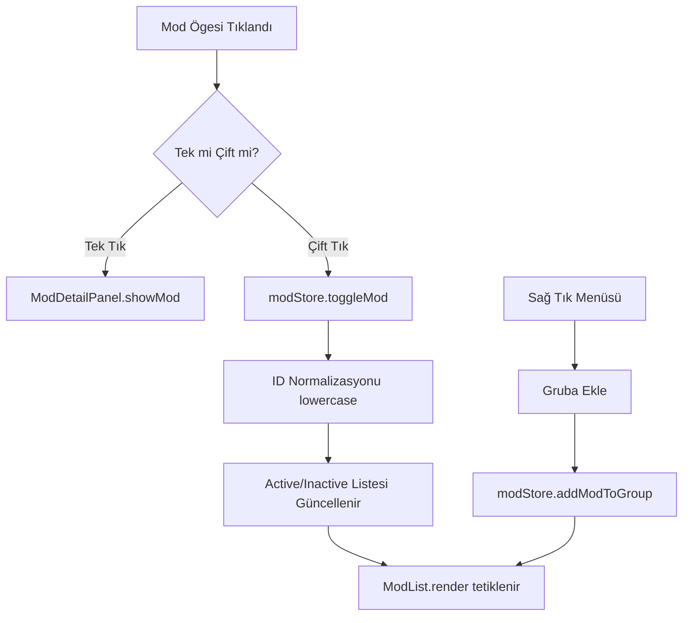

# 📋 RimWorld Başlatıcı - Mod Yönetimi İyileştirme Planı

Bu plan, mod listesi etkileşimlerini düzeltmeyi, RimSort benzeri bir gruplandırma sistemini entegre etmeyi ve aktif/pasif mod yönetimini stabilize etmeyi amaçlamaktadır.

## 🔍 Mevcut Sorun Analizi ve Kök Nedenler

1. **Mod Detay Paneli Sorunu:**
   - **Kök Neden:** `src/components/mod-list/ModList.ts` içindeki `handleSingleClick` fonksiyonu, çift tıklamayı (double-click) ayırt etmek için 300ms'lik bir bekleme süresi uygular. Ancak bu yapı bazen tek tıklamaları yutabilir veya DOM elementlerinin yeniden render edilmesi sırasında event listener'ların davranışları beklenmedik şekilde değişebilir.
   - **Çözüm:** Tıklama mantığını basitleştirmek veya detay panelinin tetiklenme mekanizmasını daha sağlam hale getirmek.

2. **Aktif/Deaktif Kontrolü Sorunu:**
   - **Kök Neden:** `src/store/modStore.ts` içinde `setActiveProfileMods` fonksiyonu ID'leri `toLowerCase()` ile normalize ederken, `toggleMod` fonksiyonu gelen `packageId`'yi olduğu gibi kullanıyor. Eğer gelen ID büyük harf içeriyorsa `indexOf` başarısız olur ve mod durumu değişmez.
   - **Çözüm:** Store içindeki tüm ID karşılaştırmalarını ve işlemlerini lowercase normalize edilmiş şekilde yapmak.

3. **Gruplama Eksikliği:**
   - **Kök Neden:** Store seviyesinde `ModGroup` yapısı mevcut ancak bunu kullanıcıya sunan bir UI (Grup oluşturma butonu, modları gruba ekleme menüsü) yok.
   - **Çözüm:** RimSort'taki "Divider" konseptini uygulayarak, grup yönetimini hem sağ tık menüsüne hem de ana arayüze eklemek.

---

## 🛠️ Uygulama Adımları

### 1. Veri Modeli ve Store Düzenlemeleri (`src/types/mod.ts`, `src/store/modStore.ts`)

**Amacı:** ID tutarlılığını sağlamak ve grup yönetimini genişletmek.

- [ ] **`src/store/modStore.ts`**:
    - `toggleMod(packageId: string)` metodunu güncelle: `packageId` parametresini ilk satırda `toLowerCase()` yap.
    - `moveModBetweenShelves` ve `moveGroupBetweenShelves` metodlarında ID karşılaştırmalarını lowercase normalize et.
    - `reorderActiveMods` ve `reorderLibraryMods` metodlarında ID karşılaştırmalarını lowercase normalize et.
    - `addModToGroup` ve `removeModFromGroup` metodlarına lowercase normalizasyonu ekle.

### 2. Mod Detay Paneli ve Tıklama Mantığı (`src/components/mod-list/ModList.ts`)

**Amacı:** Detay panelinin her tıklamada anında tepki vermesini sağlamak.

- [ ] **`src/components/mod-list/ModList.ts`**:
    - `handleSingleClick` içindeki 300ms bekleme mantığını gözden geçir. Detay panelini anında tetikle, ancak çift tıklandığında toggle işleminin detay panelini ezmediğinden emin ol.
    - `createModElement` içinde `modElement`'e eklenen `click` event'inin `stopPropagation()` kullanımını ve bubbling sırasını kontrol et.

### 3. Mod Gruplama Sisteminin UI Entegrasyonu (`src/components/mod-list/ModItem.ts`, `src/components/mod-list/ModList.ts`)

**Amacı:** Kullanıcının modları gruplandırabilmesini sağlamak.

- [ ] **`src/components/mod-list/ModItem.ts`**:
    - Sağ tık (⋮) menüsüne "Gruba Ekle" seçeneği ekle.
    - "Gruba Ekle" tıklandığında, mevcut grupları listeleyen küçük bir alt menü veya basit bir prompt aç.
    - Seçilen gruba ekleme işlemini `modStore.addModToGroup(groupId, modId)` ile tetikle.

- [ ] **`src/components/mod-list/ModList.ts`**:
    - `render` metoduna, aktif liste üzerinde "Yeni Grup Oluştur" butonu ekle (veya `src/main.ts` üzerinden bir tetikleyici oluştur).
    - `renderActiveGroups` metodunu geliştir: Gruplar için daha belirgin "Divider" stilleri ekle.
    - Grup header'larına "Grubu Sil" veya "Grubu Yeniden Adlandır" seçenekleri (sağ tık veya küçük bir ikon ile) ekle.

### 4. UI/UX ve Stil İyileştirmeleri (`src/styles.css`)

**Amacı:** Grupların ve etkileşimlerin görsel olarak netleşmesi.

- [ ] **`src/styles.css`**:
    - `.group-header` için RimSort benzeri, belirgin bir ayırıcı stil tanımla.
    - Daraltılmış/Genişletilmiş grup durumları için geçiş animasyonları ekle.
    - Aktif/Pasif modların border renklerini ve hover durumlarını daha kontrast hale getir.

---

## 🗺️ İş Akışı Diyagramı (Mermaid)

## 📌 Code Mode İçin Önemli Notlar
- Projede framework olmadığı için tüm DOM manipülasyonları `document.createElement` ve `innerHTML` üzerinden yapılmaktadır.
- Store abonelikleri (`modStore.subscribe`) üzerinden render tetiklendiği için, store'daki her değişiklikten sonra `ModList.render()`'ın çağrıldığından emin olunmalıdır.
- Tüm ID işlemleri kesinlikle `toLowerCase()` üzerinden yürütülmelidir.
