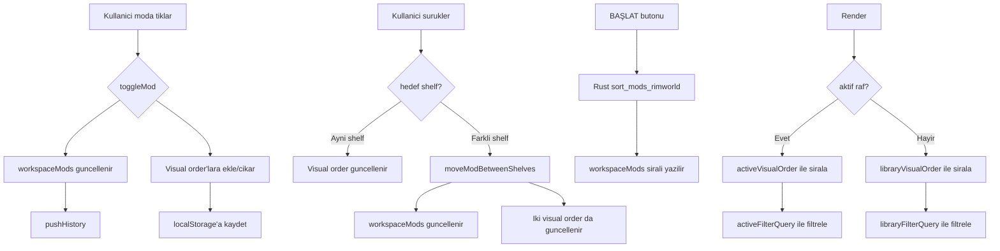

# Görsel Sıralama, Shelf Arama & Preset Aktifleştirme Planı

## Kullanıcı İstekleri (Kelimesi Kelimesine)

1. "profili aktif profil yapmaya yarayacak buton yok"
2. "sürüklediğimde sıralamayı otomatik yaptığı için direkt istediğim yere bırakmıyor"
3. "sıralamayı ayarlamak için butonlar"
4. "listelerin kendi içinde search barları"
5. "listelerin sırasını zevkime göre değiştirip kaydetme olayları"
6. "bu sıralar görsel sıralardır kaydedilir otomatik. oyuna etki etmez"
7. "oyuna girmeden önce tam otomatik sıralama olacak"

---

## Mevcut Durum Analizi

### Sorun 1: Sürükleme sonrası geri sıçrama
[`ModList.ts:423`](src/components/mod-list/ModList.ts:423) `renderShelf()` içinde aktif raftaki modlar `sortByActiveOrder()` ile **her render'da yeniden sıralanıyor**. Kullanıcı drag ile yeniden sıralasa bile, bir sonraki render'da `workspaceMods` sırasına geri dönüyor.

**Kök neden**: `workspaceMods` hem görsel sıralama HEM oyun sıralaması olarak kullanılıyor. Bu ikisi aynı olamaz.

### Sorun 2: Shelf başına arama yok
[`modStore.ts:301`](src/store/modStore.ts:301) `setFilter()` tek bir global filtre. İki shelf de aynı anda filtreleniyor. Kullanıcı kütüphanede arama yapınca aktif raf da filtreleniyor.

### Sorun 3: Preset context menu'de "Aktifleştir" yok
[`main.ts:332`](src/main.ts:332) `showPresetContextMenu()` sadece İsim Değiştir, Çoğalt, Sil seçenekleri var. Sol tıkla preset değişiyor ama sağ tık menüsünde "Aktif Yap" seçeneği yok.

---

## Mimari Değişiklik: İkili Sıralama Sistemi

```
┌─────────────────────────────────────────────────────────┐
│                     MOD STORE                           │
│                                                         │
│  workspaceMods: string[]   ← OYUN SIRASI               │
│  (toggle/drag ile değişir, BAŞLAT'ta ModsConfig.xml'e  │
│   yazılır. Rust tarafında auto-sort edilir)             │
│                                                         │
│  activeVisualOrder: string[]  ← AKTİF RAF GÖRSEL SIRA  │
│  libraryVisualOrder: string[] ← KÜTÜPHANE GÖRSEL SIRA  │
│  (sadece sürükle-bırak sıralama ile değişir,           │
│   oyuna ETKİ ETMEZ, localStorage'a kaydedilir)         │
│                                                         │
│  activeFilterQuery: string   ← AKTİF RAF ARAMA          │
│  libraryFilterQuery: string  ← KÜTÜPHANE ARAMA          │
│  (shelf başına bağımsız, diğer shelf'i etkilemez)      │
└─────────────────────────────────────────────────────────┘
```

### Veri Akışı



---

## Uygulama Adımları

### Adım 1: modStore'a görsel sıralama + per-shelf filtre ekle

**Yeni state alanları:**
```typescript
// modStore.ts
private activeVisualOrder: string[] = [];
private libraryVisualOrder: string[] = [];
private activeFilter: string = "";
private libraryFilter: string = "";
```

**Yeni metodlar:**
- `getActiveVisualOrder(): string[]` — görsel sırayı döndür
- `getLibraryVisualOrder(): string[]` — görsel sırayı döndür
- `reorderActiveVisual(draggedId, targetId)` — aktif raf görsel sırasını güncelle
- `reorderLibraryVisual(draggedId, targetId)` — kütüphane görsel sırasını güncelle
- `setActiveFilter(query)` — aktif raf filtresi
- `setLibraryFilter(query)` — kütüphane filtresi
- `syncVisualOrders()` — workspaceMods'a göre visual order'ları senkronize et (yeni mod eklenince)
- `saveVisualOrders()` / `loadVisualOrders()` — localStorage kalıcılığı

**Değişecek mevcut metodlar:**
- `toggleMod()` — visual order'a da ekle/çıkar
- `moveModBetweenShelves()` — iki visual order'ı da güncelle
- `loadWorkspaceFromProfile()` — visual order'ları localStorage'dan yükle
- `getMods()` — artık global filtre yerine `getModsForShelf()` kullanılacak

### Adım 2: ModList'te shelf başına arama + görsel sıralama

**Değişiklikler:**
- [`renderShelf()`](src/components/mod-list/ModList.ts:427) — `sortByActiveOrder` yerine ilgili visual order'ı kullan
- Shelf header'larına `<input type="search">` ekle
- `reorderActiveMods` çağrısı yerine `reorderActiveVisual` çağrısı

**HTML değişikliği** (index.html shelf-header'lara search input):
```html
<div class="shelf-header p-2 flex justify-between items-center shrink-0">
    <span>KUTUPHANE (PASIFLER)</span>
    <input id="library-search" placeholder="Ara..." class="shelf-search-input">
    <span id="library-count">0 MOD</span>
</div>
```

### Adım 3: Preset context menu'ye "Aktifleştir" ekle

[`showPresetContextMenu()`](src/main.ts:332) içine yeni menü öğesi:
```typescript
const activateItem = this.menuItem(
    '<svg>...</svg>',
    "AKTIFLESTIR",
    () => {
        menu.remove();
        profileStore.selectProfile(profileName);
        const profile = profileStore.getProfiles().find(p => p.name === profileName);
        if (profile) {
            modStore.loadWorkspaceFromProfile(profile);
        }
        // Label güncelle
        const label = document.getElementById("active-profile-label");
        if (label) label.innerText = `PROFIL: ${profileName.toUpperCase()}`;
        Toast.show(`${profileName} aktif edildi`, "success");
    }
);
```

### Adım 4: BAŞLAT — oyun sıralamasını uygula

[`saveWorkspaceToModsConfig()`](src/main.ts:202) — mevcut haliyle `workspaceMods`'u yazar. Bu sıra Rust tarafında `sort_mods_rimworld` ile auto-sort ediliyorsa değişiklik gerekmez. Kontrol et.

---

## Hangi Dosyalar Değişecek

| Dosya | Değişiklik | Kapsam |
|---|---|---|
| [`modStore.ts`](src/store/modStore.ts) | Görsel sıralama + per-shelf filtre state | Büyük |
| [`ModList.ts`](src/components/mod-list/ModList.ts) | Shelf search bar, görsel sıralama render | Büyük |
| [`main.ts`](src/main.ts) | Context menu "Aktifleştir" | Küçük |
| [`index.html`](index.html) | Shelf header search input'ları | Küçük |
| [`styles.css`](src/styles.css) | Search input stilleri | Küçük |

---

## Sıralama

1. `modStore.ts` — görsel sıralama altyapısı
2. `ModList.ts` — shelf search bar + görsel sıralama render
3. `index.html` — search input HTML
4. `styles.css` — search input CSS
5. `main.ts` — context menu "Aktifleştir"
6. Derleme ve test
